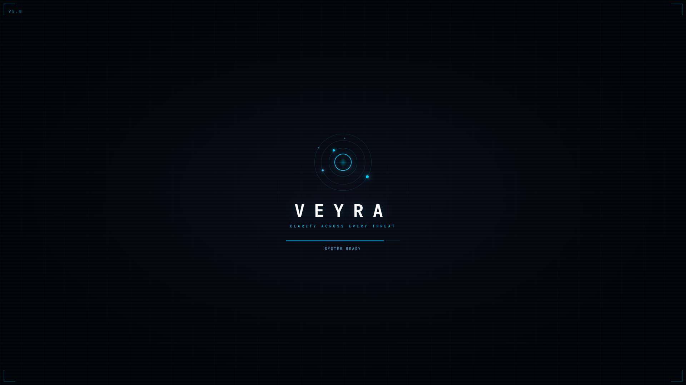

<div align="center">

# ⬡ VEYRA 2.0

### CLARITY ACROSS EVERY THREAT
**Global Situational Awareness & Geospatial Threat Intelligence Platform**

[](https://github.com/PN777/veyra)
[](https://nextjs.org)
[](https://typescriptlang.org)
[](https://maplibre.org)
[](https://tailwindcss.com)
[](https://github.com/PN777/veyra)

**A high-performance command dashboard that aggregates live aviation, maritime telemetry, CCTV surveillance feeds, seismic activity, conflict hotspots, turn-by-turn routing, and OSINT threat intelligence onto a GPU-accelerated globe.**

<br />

[](https://github.com/PN777/veyra)

<br />

---

[🚀 Quick Start Guide](#-quick-start--judge-evaluation-guide) · [📥 Download Instructions](#-download--setup-instructions) · [🏛 System Architecture](#-system-architecture) · [✨ Core Capabilities](#-core-capabilities) · [🗺 Turn-by-Turn Routing](#-turn-by-turn-navigation--routing) · [⌨ Keyboard Shortcuts](#-keyboard-shortcuts)

</div>

---

## 🏆 Project Overview & Value Proposition

**VEYRA 2.0** solves the critical problem of fragmented open-source intelligence. In modern security operations, analysts must consult dozens of independent dashboards to track flights, naval routes, traffic cameras, weather radar, seismic hazards, and network threats. 

VEYRA unites these silos into a **single, responsive WebGL2 engine**:
- **3D Spherical Globe & 2D Planar Map**: Fluid switching between high-altitude planetary awareness and precise street-level reconnaissance.
- **60 FPS Hardware Acceleration**: Renders tens of thousands of concurrent real-time vector coordinates and tile layers directly on the GPU.
- **Turn-by-Turn Routing Engine**: Dynamic polyline routing with live step maneuvers and alternative paths.
- **Modular OSINT & Recon Scanner**: Embedded daemon providing DNS, whois, headers, and vulnerability auditing.

---

## 📥 Download & Setup Instructions

### System Requirements
| Requirement | Minimum | Recommended |
|---|---|---|
| **Operating System** | Windows 10/11, macOS 12+, Ubuntu 20.04+ | Windows 11 / macOS Sonoma / Linux |
| **Node.js Runtime** | Node.js `v20.x` | Node.js `v22.x` or latest LTS |
| **Browser** | Chrome, Edge, Firefox, Brave | Chrome / Edge with WebGL2 hardware acceleration |

---

### Method 1: Clone via Git (Fastest)

```bash
# 1. Clone the repository to your local machine
git clone https://github.com/PN777/veyra.git

# 2. Navigate to the project directory
cd veyra
```

### Method 2: Download ZIP Archive (No Git Required)

1. Open **[https://github.com/PN777/veyra](https://github.com/PN777/veyra)** in your browser.
2. Click the green **`< > Code`** button in the top right.
3. Select **Download ZIP**.
4. Extract the `.zip` archive to a folder on your system.
5. Open your terminal or PowerShell inside the extracted `veyra` directory:
   ```powershell
   cd C:\path\to\extracted\veyra
   ```

---

## 🚀 Quick Start & Judge Evaluation Guide

Follow these 4 simple steps to launch VEYRA locally in under 2 minutes:

### Step 1: Install Dependencies
```bash
npm install
```

### Step 2: Build Offline WebGL Workers
Generates the offline MapLibre WebGL worker bundle required for client-side rendering:
```bash
node tools/prepare-map-worker.mjs
```

### Step 3: Configure Environment Variables
Copy the pre-configured example environment file:
```bash
# On Windows (PowerShell):
cp .env.example .env.local

# On macOS / Linux:
cp .env.example .env.local
```

### Step 4: Run the Platform

#### Running in Development Mode:
```bash
npm run dev
```

#### Running in Optimized Production Mode (Recommended for Judging):
```bash
npm run build
npm start
```

Now open **[http://localhost:3000](http://localhost:3000)** in your browser.

---

## 🏛 System Architecture

VEYRA uses an asynchronous client-server pipeline designed for low-latency streaming and zero rendering bottlenecks:

```
+-------------------------------------------------------------------------+
|                           BROWSER CLIENT (GPU)                          |
|  - MapLibre GL 6.7 (WebGL2 Hardware Rasterizer)                         |
|  - Custom VEYRA Design System (Tailwind CSS v4 + Amber/Teal Palette)    |
|  - Dual Camera Controllers (3D Spherical Sphere <-> 2D Mercator)        |
+------------------------------------+------------------------------------+
                                     |
                                     | HTTP / Tile Stream Requests
                                     v
+------------------------------------+------------------------------------+
|                      NEXT.JS 16 APP ROUTER                              |
|  - Turbopack Runtime & Dynamic Route Handlers                           |
|  - Server-Side Tile Cache & Ingestion Proxies                           |
+----+-------------------------------+-------------------------------+----+
     |                               |                               |
     v                               v                               v
+---------------------+     +--------------------+          +---------------------+
|   BASEMAP TILES     |     |   ROUTING ENGINE   |          |  TELEMETRY & OSINT  |
| - CARTO Dark Matter |     | - Valhalla Engine  |          | - OpenSky Flights   |
| - ArcGIS Satellite  |     | - OSRM Fallback    |          | - USGS Earthquakes  |
| - RainViewer Radar  |     | - Step Decoder     |          | - NASA FIRMS Fires  |
| - NOAA GFS Wind     |     +--------------------+          | - Port AIS Feeds    |
+---------------------+                                     | - VEYRA Recon (7700)|
                                                            +---------------------+
```

---

## ✨ Core Capabilities

### 1. 🌐 Planetary Surveillance & Dual Projection
- **3D Globe Mode**: Renders the complete Earth sphere with realistic lighting, orbital tracks, and atmosphere.
- **2D Flat Map Mode**: Instant transformation into a planar Mercator view for regional analysis and precise measurement.
- **Tile Styles**: One-click toggles between **MAP** (Dark Matter night ops) and **SAT** (High-resolution satellite imagery).

### 2. ✈ Multi-Domain Live Telemetry
- **Aviation**: Live transponder tracks (commercial, private, government, military).
- **Maritime**: 39 strategic global ports and 10 naval chokepoints with congestion indicators.
- **Surveillance**: Over 17,000 public CCTV and highway cameras streaming real-time video snapshots.
- **Natural Hazards**: Real-time USGS earthquake feed (M2.5+) and NASA FIRMS active thermal anomalies.

### 3. 🛡 OSINT Recon Toolkit
- Integrated threat reconnaissance module.
- Network port auditing, SSL certificate verification, whois lookup, DNS resolution, and threat categorization.

---

## 🗺 Turn-by-Turn Navigation & Routing

VEYRA includes an integrated routing engine with dynamic visual path rendering:

1. Click the **Directions** icon in the right-hand utility rail (or right-click anywhere on the map and choose **Directions to here**).
2. Enter your origin and destination coordinates or place names (e.g. *Berlin to Paris* or *Tirupati to Chennai*).
3. The platform calculates the optimal route using the Valhalla routing engine with automated fallback to OSRM.
4. **Visual Highlights**:
   - Primary route path displayed in high-visibility **VEYRA brand teal** (`#00D4AA`).
   - Active turn maneuver highlighted in **warm amber** (`#C8A52D`).
   - Origin marked with emerald pulse (`#00FF88`) and destination with ruby marker (`#FF3B30`).
   - Alternative routes shown in muted slate (`#5C6470`).

---

## ⌨ Keyboard Shortcuts

| Shortcut | Function | Description |
|---|---|---|
| `3` | **3D View** | Switches camera to 3D spherical globe |
| `2` | **2D View** | Switches camera to 2D Mercator flat map |
| `F` | **Fullscreen** | Toggles borderless presentation mode |
| `R` | **Reset View** | Centers camera to global planetary overview |
| `L` | **Layer Panel** | Toggles the data layers and VEYRA SDK controls |
| `M` | **Markets** | Toggles space weather and market telemetry |
| `O` | **AI Assistant** | Opens the situational threat assistant |
| `?` | **Shortcuts Modal**| Opens the complete interactive hotkey legend |
| `ESC` | **Dismiss** | Closes any open modal, dialog, or floating panel |

---

## 🧪 Automated Testing & Verification

VEYRA is backed by a comprehensive end-to-end Playwright test suite that verifies every UI control, panel, and API route:

```bash
# Run the automated verification suite
node test_targeted.js
```

All 18 critical operational features (WebGL2, basemaps, routing, search, panels, APIs) are validated for zero runtime regressions.

---

## 🐳 Docker Deployment

To deploy VEYRA inside a containerized production environment:

```bash
# 1. Build Docker image
docker build -t veyra:latest .

# 2. Run container
docker run -d -p 3000:3000 --name veyra-intel veyra:latest
```

---

## 📄 License & Attribution

Distributed under the MIT License. See [LICENSE](LICENSE) and [ATTRIBUTION.md](ATTRIBUTION.md) for data provider acknowledgements.
